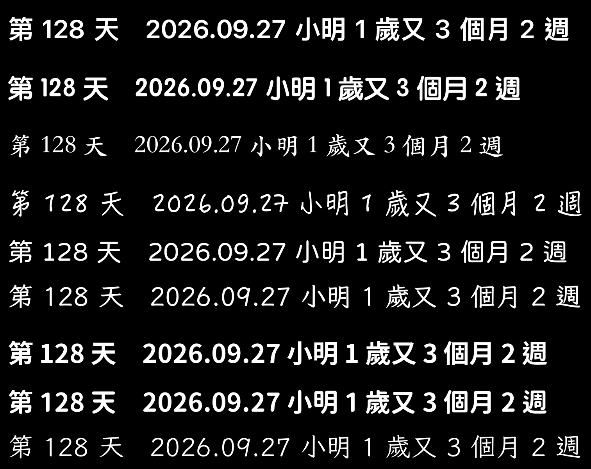

# 繁中字型來源實測（Issue #73）

> 調查卡產出，不改產品程式碼。實測日期 2026-09-27，環境：Xcode 27.0、iOS 18.3 模擬器（iPhone 16）。
> 本文件**不選定最終字型清單**（F.5），只提供建議與取捨，由人類在字型比較設計稿上挑選。

## 0. 結論摘要

- **現況確認**：目前 10 種字型遇到中文時，CoreText 會逐段切到 `PingFangTC-Semibold`（見 §C 基準），所以選哪個字型中文都一樣。
- **系統可下載字型（A）**：iOS 字型目錄裡有 17 個繁中家族可用 `CTFontDescriptorMatchFontDescriptorsWithProgressHandler` 下載，**全部下載成功**。下載量 4–66 MB、模擬器上 5–56 秒；**不佔 App 大小**。缺點：每次 App 啟動都要重新比對（約 0.2 秒/套，不會重新下載），首次使用需要網路與等待，而且**授權沒有找到 Apple 的明文許可**（未確認）。
- **打包開源字型（B）**：8 套候選全部是 SIL OFL 1.1，可打包進 App 散布，4808 常用字全數涵蓋。單一字重 4.9–29 MB（壓縮後 2.9–13 MB）；若裁成「4808 字＋ASCII＋全形標點」子集，每套約 1.5–3.9 MB。
- **烘焙正確性（C）**：A、B 共 8 套實測，整串文字（中文＋數字＋全形空白）全部由指定字型繪製，沒有退回蘋方；觀景窗的 SwiftUI `Text` 與烘焙用的 `NSString.draw` 墨跡寬度逐像素相同。
- **建議方案**：**打包 3–4 套開源字型（子集化）＋系統下載 3–4 套**。開源字型保證離線可用、授權清楚，放「預設可用」；系統字型補書法／手寫等開源缺少的風格，放「需下載」。若人類不想處理下載流程，只打包開源字型也是可行的簡化版本。詳見 §5。

## A. iOS 系統可下載的繁中字型

### 方法

`DaysCamTests/Research/FontsTCResearchTests.swift`：

- `test_A1`：以 `kCTFontDownloadableAttribute: true` 查詢字型目錄（共 1260 筆），列出顯示名稱含漢字者。模擬器上各筆的 `kCTFontLanguagesAttribute` 都是空的，所以改用顯示名稱篩選。
- `test_A2`：每個字型先檢查 `UIFont(name:)`，再呼叫 `CTFontDescriptorMatchFontDescriptorsWithProgressHandler` 下載，記錄 `kCTFontDescriptorMatchingTotalAssetSize`（下載量）、耗時、下載後的檔案大小（整個家族的 `.ttc`）與 4808 字涵蓋率。
- `test_A3`：**另起一次 `xcodebuild test`（新 process = App 重啟）**，先檢查 `UIFont(name:)`，再比對一次。

每個家族挑一個代表字重（有粗體就用粗體）。

### 結果（F.2）

| 字型（繁中名） | PostScript 名稱（測的字重） | 目錄裡其他字重 | 能否下載 | 下載量 | 耗時 | 家族檔案 | 4808 涵蓋 | 重啟後 |
|---|---|---|---|---|---|---|---|---|
| 宋體-繁 | `STSongti-TC-Bold` | Regular、Light | 可（見註 1） | 43.7 MB | 51.6 s | Songti.ttc 66.9 MB | 4808 | 需重新比對 |
| 楷體-繁 | `STKaitiTC-Bold` | Regular、Black | 可 | 66.1 MB | 41.8 s | Kaiti.ttc 106.2 MB | 4808 | 需重新比對 |
| 圓體-繁 | `STYuanti-TC-Bold` | Regular、Light | 可 | 46.5 MB | 39.7 s | Yuanti.ttc 79.2 MB | 4808 | 需重新比對 |
| 隸變-繁 | `STLibianTC-Regular` | — | 可 | 21.6 MB | 17.1 s | Libian.ttc 36.0 MB | 4808 | 需重新比對 |
| 翩翩體-繁 | `HanziPenTC-W5` | W3 | 可 | 48.7 MB | 33.2 s | Hanzipen.ttc 71.9 MB | 4807（缺「彞」） | 需重新比對 |
| 手札體-繁 | `HannotateTC-W7` | W5 | 可 | 50.0 MB | 55.8 s | Hannotate.ttc 85.4 MB | 4807（缺「彞」） | 需重新比對 |
| 魏碑-繁 | `WeibeiTC-Bold` | — | 可 | 11.0 MB | 12.0 s | WeibeiTC-Bold.otf 14.9 MB | 4807（缺「彞」） | 需重新比對 |
| 蘭亭黑-繁 | `FZLTZHB--B51-0`（中黑） | 纖黑 `FZLTXHB--B51-0`、特黑 `FZLTTHB--B51-0` | 可 | 25.2 MB | 24.6 s | Lantinghei.ttc 43.2 MB | 4807（缺「彞」） | 需重新比對 |
| 娃娃體-繁 | `DFWaWaTC-W5` | — | 可 | 11.6 MB | 10.3 s | WawaTC-Regular.otf 17.5 MB | 4808 | 需重新比對 |
| 雅痞-繁 | `YuppyTC-Regular` | — | 可 | 12.9 MB | 17.7 s | YuppyTC-Regular.otf 16.2 MB | 4808 | 需重新比對 |
| 凌慧體-繁 | `MLingWaiMedium-TC` | — | 可 | 18.4 MB | 12.0 s | LingWaiTC-Medium.otf 24.2 MB | 4808 | 需重新比對 |
| 行楷-繁 | `STXingkaiTC-Bold` | Light | 可 | 54.8 MB | 34.7 s | Xingkai.ttc 88.8 MB | 4808 | 需重新比對 |
| 報隸-繁 | `STBaoliTC-Regular` | — | 可 | 25.6 MB | 15.8 s | Baoli.ttc 42.4 MB | 4808 | 需重新比對 |
| 標楷體-繁 | `BiauKaiTC-Regular` | — | 可 | 17.8 MB | 12.1 s | BiauKai.ttc 28.5 MB | 4808 | 需重新比對 |
| 儷黑 Pro | `LiHeiPro` | — | 可 | 4.2 MB | 4.9 s | LiHeiPro.ttf 7.0 MB | 4808 | 需重新比對 |
| 儷宋 Pro | `LiSongPro` | — | 可 | 7.1 MB | 6.0 s | LiSongPro.ttf 14.1 MB | 4808 | 需重新比對 |
| 冬青黑體繁體中文 | `HiraginoSansTC-W6` | W3 | 可 | 14.1 MB | 8.0 s | Hiragino_Sans_TC.ttc 16.7 MB | 4807（缺「彞」） | 需重新比對 |

目錄中另有 `LiGothicMed`（蘋果儷中黑）、`LiSungLight`（蘋果儷細宋）、`DFKaiShu-SB-Estd-BF`（標楷體）、`HiraginoSansCNS-W3/W6` 等較舊或重複的繁中字型，以及 `STHeitiTC-*`（黑體-繁，已內建、不需下載），沒有逐一實測。

- **註 1**：宋體-繁下載過程回報一次 `CTFontManagerErrorDomain` #302，但最後仍 `didMatch`、`UIFont(name:)` 可用。原因未查明（未確認），實作時錯誤處理要以「最後是否比對成功」為準，不要一見錯誤就判定失敗。
- **「彞」**：教育部字表的 01266 是 U+5F5E「彞」，日常通用字是 U+5F5D「彝」（字表來源已註明此出入）。缺字的 5 套只缺這個異體，實務上不影響。
- 耗時是模擬器＋開發機網路的數字，實機行動網路會更久；下載量才是比較穩定的參考。
- **檔案位置**：下載到系統的 `MobileAsset/AssetsV2/com_apple_MobileAsset_Font7/`，不在 App 的容器裡，**不計入 App 大小**。系統在儲存空間不足時會不會清掉它：**未確認**。其他 App 下載過的同一套字型能否直接共用：**未實測**。

### 重啟後的行為

`test_A3`（新 process）的結果對 17 套都一樣：

- 重啟後 `UIFont(name:)` 直接回傳 `nil`，一般的 `CTFontDescriptorCreateMatchingFontDescriptor` 也比對不到。
- 再呼叫一次 `CTFontDescriptorMatchFontDescriptorsWithProgressHandler`：狀態只有 `didBegin > didFinishDownloading > didMatch > didFinish`，下載量 0，**約 0.2 秒**完成，之後 `UIFont(name:)` 可用。

也就是說：**每次 App 啟動都要對使用者用到的系統字型重新比對一次**。實作上需要在啟動時（或在用到該字型前）非同步比對，比對完成前觀景窗會先以蘋方顯示——要避免這時候按快門烘焙出蘋方（見 §5 風險）。

### 授權

- iOS 18／iOS 26 的軟體授權合約（[iOS 18 SLA](https://www.apple.com/legal/sla/docs/iOS18_iPadOS18.pdf)、[iOS 26 SLA](https://www.apple.com/legal/sla/docs/iOS26_iPadOS26.pdf)）只在第 1(a) 條把 fonts 列為 Apple Software 的一部分，**沒有**像 macOS 那樣的字型專條。
- [macOS Sequoia SLA](https://www.apple.com/legal/sla/docs/macOSSequoia.pdf) 第 2.E 條：「you may use the fonts included with the Apple Software to display and print content while running the Apple Software; however, you may only embed fonts in content if that is permitted by the embedding restrictions accompanying the font」。烘焙是把文字畫成像素，不嵌入字型檔，按 macOS 條文的精神屬於「display and print content」；但這是 macOS 條款，**不能直接套到 iOS**。
- Apple 提供這個下載 API 給第三方 App 使用（CoreText 公開 API），但**沒有找到 Apple 對「App 內使用系統可下載字型並烘焙進使用者照片」的官方明文許可或限制**。
- 結論：**未確認**。這些字型多數是第三方字廠（華康、方正、常州華文、Hiragino 等）授權給 Apple，若要正式上架前定案，建議人類向 Apple Developer 支援詢問或自行判斷風險。

## B. 打包開源繁中字型

### 方法

- 字型檔從官方 GitHub release／repo 下載到 scratch（**未加入 repo 或 App target**）。
- 用 `fontTools` 讀 `cmap`，對《常用國字標準字體表》4808 字（字表來源：[ButTaiwan/cjktables `taiwan/standard/edu_standard_1.txt`](https://github.com/ButTaiwan/cjktables/blob/master/taiwan/standard/edu_standard_1.txt)）逐字檢查；另外檢查疊字會用到的字元：`0-9 . 第天歲個月年又週尚未開始`、半形空白與全形空白 U+3000（`TemplateRenderer.dateSeparator`）。
- 「壓縮後」是 `gzip -9` 的大小，近似 App Store 下載時的壓縮量；「子集」是用 `pyftsubset` 裁成 4808 字＋「彝」＋ASCII＋全形標點（U+3000–303F、U+FF01–FF5E）後的大小。
- `test_B1` 在模擬器以 `CTFontManagerRegisterFontsForURL(.process)` 註冊，確認 PostScript 名稱可用 `UIFont(name:)` 載入。

### 結果（F.3）

| 字型 | 版本／測的字重 | PostScript 名稱 | 授權 | 可否打包 | 單檔大小 | 壓縮後 | 子集 | 4808 涵蓋 | 疊字用字 |
|---|---|---|---|---|---|---|---|---|---|
| jf open 粉圓 | 2.1（僅一個字重） | `jf-openhuninn-2.1` | [OFL 1.1](https://github.com/justfont/open-huninn-font/blob/master/LICENSE)（漢字部分衍生自 Kosugi Maru，Apache-2.0） | 可 | 4.9 MB | 2.9 MB | 2.0 MB | 4808 (100%) | 全有 |
| 霞鶩文楷 TC | 1.522 Medium（最粗為 Medium） | `LXGWWenKaiTC-Medium` | [OFL 1.1](https://github.com/lxgw/LxgwWenkaiTC/blob/main/OFL.txt) | 可 | 15.0 MB | 9.0 MB | 3.4 MB | 4808 (100%) | 全有 |
| 芫荽 Iansui | 1.020（僅 Regular） | `Iansui-Regular` | [OFL 1.1](https://github.com/ButTaiwan/iansui/blob/main/OFL.txt) | 可 | 9.4 MB | 4.9 MB | 3.9 MB | 4808 (100%) | 全有 |
| 源泉圓體 TW | 2.100 Bold | `GenSenRounded2TW-B` | [OFL 1.1](https://github.com/ButTaiwan/gensen-font/blob/master/SIL_Open_Font_License_1.1.txt)（保留名 “Source”） | 可 | 15.8 MB | 10.4 MB | 2.1 MB | 4808 (100%) | 全有 |
| 獅尾圓體 | 2.140 Bold | `SweiGothicCJKtc-Bold` | [OFL 1.1](https://github.com/max32002/swei-gothic/blob/master/SIL_Open_Font_License_1.1.txt) | 可 | 15.8 MB | 8.8 MB | 1.9 MB | 4808 (100%) | 全有 |
| 獅尾加糖宋體 | 1.061 Bold | `SweiSugarCJKtc-Bold` | [OFL 1.1](https://github.com/max32002/swei-sugar/blob/master/SIL_Open_Font_License_1.1.txt) | 可（見註 2） | 29.0 MB | 13.3 MB | 3.5 MB | 4808 (100%) | 全有 |
| 思源黑體／Noto Sans TC | 2.004 Bold（SubsetOTF） | `NotoSansTC-Bold` | [OFL 1.1](https://github.com/notofonts/noto-cjk/blob/main/Sans/LICENSE) | 可 | 5.8 MB | 5.1 MB | 1.5 MB | 4808 (100%) | 全有 |
| 思源宋體／Noto Serif TC | 2.003 Bold（SubsetOTF） | `NotoSerifTC-Bold` | [OFL 1.1](https://github.com/notofonts/noto-cjk/blob/main/Serif/LICENSE) | 可 | 8.3 MB | 7.1 MB | 2.1 MB | 4808 (100%) | 全有 |

8 套的 OS/2 `fsType` 都是 0（無嵌入限制）。

- **OFL 1.1 對打包的要求**：可隨軟體打包、散布、販售（不能單獨販售字型本身）；必須附上**版權聲明與 OFL 全文**（可放獨立文字檔，或放在使用者看得到的地方）。實作時建議在 App 裡加一個「字型授權」頁，並把各字型的 `OFL.txt` 放進 bundle。
- **子集化＝修改**：OFL 把子集化視為 Modified Version，**不能再使用保留字型名稱（RFN）**。有 RFN 的：粉圓（“open huninn”、“huninn”，以及其中 Varela Round 的 “Varela”）、源泉圓體（Adobe 的 “Source”）。要子集化這兩套就得改字型內部名稱；Noto、霞鶩文楷、芫荽、獅尾系列的授權檔**沒有**宣告 RFN。
- **粉圓的 Apache-2.0 部分**：漢字衍生自 Kosugi Maru（Apache-2.0）。Apache-2.0 要求散布時附授權全文與既有的 NOTICE；repo 裡沒有 NOTICE 檔，附上 LICENSE 全文應已足夠（這是我的判讀，未經法律確認）。
- **註 2**：獅尾加糖宋體的字型內部 family 名稱是 “Swei Spring CJK TC”、`name` 表沒有版權與授權欄位，只靠 repo 的授權檔；檔案也是 8 套裡最大的。打包前要人工再確認一次。
- **字重**：現有 10 種字型都固定用粗體（FR-10.3）。粉圓、芫荽只有一個字重，霞鶩文楷 TC 最粗為 Medium，放進來會比其他選項細，設計稿比較時要注意。

## C. 烘焙正確性（F.4）

### 方法

`OverlayRenderer.bake` 只接受 `OverlayFontID`，這個列舉目前沒有中文字型；要把任意字型傳進去就得改產品程式碼（違反 F.6）。所以 `test_C1` 用**與 renderer 相同的繪製呼叫**（`NSString.draw(at:withAttributes:)`＋`.font`），字級用 `OverlayMetrics.baseFontSize(forShortEdge: 1200)`（1200 × 1600 照片的字級），然後：

1. 以 `CTLineGetGlyphRuns` 讀出每一段文字實際使用的字型 PostScript 名稱（CoreText 的字型退回會在這裡現形）。
2. 另外用 `ImageRenderer` 畫觀景窗的做法（SwiftUI `Text`＋`Font(uiFont)`，與 `OverlayTextView` 相同），比較兩張圖的墨跡寬度。
3. 最後用**真正的 `OverlayRenderer`**、字型 Futura 烘焙一張，作為「現況會退回蘋方」的基準。

測試字串：`第 128 天　2026.09.27 小明 1 歲又 3 個月 2 週`（涵蓋疊字所有中文、數字、`.`、半形與全形空白）。

### 結果

| 來源 | 指定字型 | 實際使用的字型（每段） | 烘焙墨跡寬 | 預覽墨跡寬 |
|---|---|---|---|---|
| A 系統下載 | `STYuanti-TC-Bold` | 整串 `STYuanti-TC-Bold` | 1310 | 1310 |
| A 系統下載 | `STKaitiTC-Bold` | 整串 `STKaitiTC-Bold` | 1261 | 1261 |
| A 系統下載 | `HanziPenTC-W5` | 整串 `HanziPenTC-W5` | 1458 | 1458 |
| B 打包 | `jf-openhuninn-2.1` | 整串 `jf-openhuninn-2.1` | 1426 | 1426 |
| B 打包 | `LXGWWenKaiTC-Medium` | 整串 `LXGWWenKaiTC-Medium` | 1461 | 1461 |
| B 打包 | `NotoSansTC-Bold` | 整串 `NotoSansTC-Bold` | 1378 | 1378 |
| B 打包 | `GenSenRounded2TW-B` | 整串 `GenSenRounded2TW-B` | 1376 | 1376 |
| B 打包 | `Iansui-Regular` | 整串 `Iansui-Regular` | 1461 | 1461 |
| 對照 | `PingFangTC-Semibold` | — | 1433 | — |
| 基準（真 `OverlayRenderer`） | Futura | 中文段落 `PingFangTC-Semibold`、數字段落 `Futura-Bold` 交錯 | — | — |

8 套都沒有任何一段退回蘋方；墨跡寬度與蘋方不同，也證實畫出來的不是蘋方。觀景窗與烘焙的寬度逐像素相同。

烘焙結果（由上而下：蘋方對照、圓體-繁、楷體-繁、翩翩體-繁、粉圓、霞鶩文楷 TC、Noto Sans TC、源泉圓體、芫荽）：



現況基準（真 `OverlayRenderer`＋Futura，右下角）：[`fonts-tc/baseline-futura.png`](fonts-tc/baseline-futura.png)

### 實作時要注意

- 系統下載字型：比對完成前 `UIFont(name:)` 是 `nil`，而 `OverlayMetrics.font(for:size:)` 目前遇到 `nil` 會退回系統字型。實作時要讓「字型還沒就緒」成為可見狀態（例如禁止快門或提示），否則會烘焙出與使用者選的不同的字型，而且永久留在照片上。
- 打包字型：在 `Info.plist` 的 `UIAppFonts` 登記即可在啟動時自動註冊，不需要比對流程。

## D. App 大小的替代方案

- 目前 Debug 模擬器 build 的 `DaysCam.app` 約 7.1 MB。打包 4 套完整字型會增加約 25–60 MB（依選哪幾套），子集化後約 6–12 MB。
- **On-Demand Resources（`NSBundleResourceRequest`）已在 iOS 27 標為 deprecated**，官方說明為「Use Background Assets instead」（[文件](https://developer.apple.com/documentation/foundation/nsbundleresourcerequest)）。新專案不建議採用。
- 替代的 **Background Assets／Apple-hosted asset packs**（`AssetPackManager`）需要 **iOS 26.0 以上**（[文件](https://developer.apple.com/documentation/backgroundassets/assetpackmanager)），而本專案 deployment target 是 iOS 18.0。要用就得提高最低版本，或自架下載伺服器（自架就要處理主機、流量與驗證，超出 MVP）。
- 要改的地方（若採用下載式打包字型）：字型改由程式在下載完成後 `CTFontManagerRegisterFontsForURL` 註冊（不能用 `UIAppFonts`）；需要「下載中／未下載」的 UI 狀態；App Store Connect 上傳 asset pack；以及與 §C 相同的「字型未就緒不可烘焙」保護。
- **建議**：先用**子集化**解決大小問題（每套約 1.5–4 MB，4 套約 10 MB 以內），不引入下載式資源。代價是使用者名字若用到 4808 字以外的字會退回蘋方（可擴大到次常用字表來降低機率，大小會跟著增加），以及 §B 的 RFN 改名問題。

## 5. 建議方案與取捨（F.5，不選定清單）

**建議：打包 3–4 套開源字型（子集化）＋系統下載 3–4 套。**

| | 打包開源（B） | 系統下載（A） |
|---|---|---|
| App 大小 | 每套 +1.5–4 MB（子集）／+5–29 MB（完整） | 0 |
| 首次使用 | 立即可用、離線可用 | 需網路，4–66 MB，數秒到近一分鐘 |
| 每次啟動 | 自動註冊 | 需重新比對（約 0.2 s/套），未就緒前不能烘焙 |
| 授權 | OFL 1.1，清楚；需附授權頁 | **未確認** |
| 風格 | 黑、圓、宋、楷、手寫感 | 多了書法（行楷、魏碑、隸書）、手寫（翩翩、手札）、可愛（娃娃、雅痞）等開源缺少的風格 |
| 實作量 | 小 | 中（下載 UI、狀態、錯誤處理） |

各自值得優先考慮的（僅供設計稿選材）：

- **B（打包）**：jf open 粉圓（最小、圓潤、台灣字形）、Noto Sans TC Bold（最穩的黑體、子集最小）、霞鶩文楷 TC（手寫楷書風，但最粗只到 Medium）。其次：源泉圓體、Noto Serif TC、芫荽、獅尾圓體。
- **A（系統）**：圓體-繁（有粗體、4808 全涵蓋）、翩翩體-繁（手寫風，有 W5 粗）、魏碑-繁（書法風、只有 11 MB）。其次：楷體-繁、手札體-繁、娃娃體-繁、隸變-繁。

若人類決定**不處理下載流程**：只打包 4–6 套開源字型（子集化約 10–15 MB）即可涵蓋黑／圓／宋／楷／手寫五種風格，實作最簡單；缺的是書法類風格。

## 6. 未確認事項

1. Apple 是否允許 App 使用系統可下載字型並烘焙進使用者照片（§A 授權）。
2. 系統下載字型在裝置儲存空間不足時是否會被系統清除；其他 App 下載過的字型能否直接共用。
3. 宋體-繁下載時出現的 `CTFontManagerErrorDomain` #302 的原因（最後仍成功）。
4. 實機（非模擬器）的下載時間與行為；本次只在 iOS 18.3 模擬器實測。
5. 粉圓的 Apache-2.0 漢字部分是否需要額外的 NOTICE（我的判讀是附 LICENSE 全文即可）。
6. 獅尾加糖宋體字型內部名稱與 repo 名稱不一致、內部無授權欄位（§B 註 2）。

## 7. 如何重現

實測程式在 `DaysCamTests/Research/FontsTCResearchTests.swift`，**平常的測試會自動 skip**，只有設了環境變數才跑。字型檔不在 repo 裡，要自行下載到某個資料夾（例如上表的連結）。

```sh
xcodegen generate
SIM=<你的模擬器 id>
export TEST_RUNNER_DAYSCAM_FONT_RESEARCH=1
export TEST_RUNNER_DAYSCAM_FONT_RESEARCH_CHARS=/path/chars4808.txt   # 每行一字
export TEST_RUNNER_DAYSCAM_FONT_RESEARCH_FONTS=/path/fonts           # 放 B 的 ttf/otf
export TEST_RUNNER_DAYSCAM_FONT_RESEARCH_OUT=/path/out               # 烘焙圖輸出
export TEST_RUNNER_DAYSCAM_FONT_RESEARCH_NAMES="STYuanti-TC-Bold,STKaitiTC-Bold,HanziPenTC-W5"
export TEST_RUNNER_DAYSCAM_FONT_RESEARCH_BAKE="STYuanti-TC-Bold,STKaitiTC-Bold,jf-openhuninn-2.1,LXGWWenKaiTC-Medium"
run() { xcodebuild -project DaysCam.xcodeproj -scheme DaysCam \
  -destination "platform=iOS Simulator,id=$SIM" test \
  -only-testing:DaysCamTests/FontsTCResearchTests/$1 2>&1 | grep RESEARCH; }
run test_A1_listDownloadableChineseFonts
run test_A2_downloadCandidates
run test_A3_afterRelaunch        # 要另外跑一次，才是新 process
run test_C1_bakeAndIdentifyUsedFonts
```

4808 字表可由 `edu_standard_1.txt` 去掉 `#` 開頭的行、取第一欄產生：`grep -v '^#' edu_standard_1.txt | cut -f1 > chars4808.txt`。
